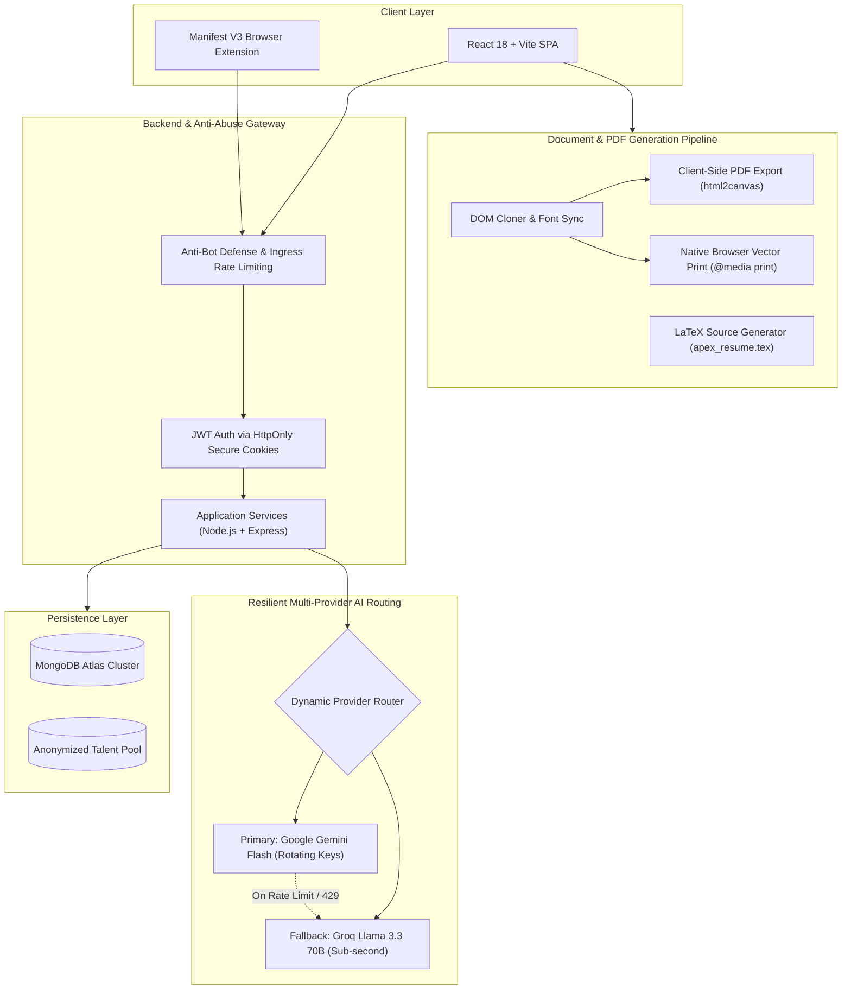

# How I Built My First Startup as a College Student

### From a ₹9 customer to building and operating an AI career platform.
*The engineering, mistakes, failures, and lessons along the way.*

A public build journal by **Naveen Beniwal** · Final-year Computer Engineering student, NIT Kurukshetra

[Try the product](https://www.cvinsight.me/) · [Explore the features](#what-i-ended-up-building) · [Read the engineering story](#5-the-part-tutorials-dont-teach-you) · [Interview stories](https://www.cvinsight.me/interview-stories) · [Free LaTeX Template](./apex_resume.tex)

This isn't a guide to getting rich in college. It's a record of building something, finding users, breaking things, fixing them, and figuring out whether I could keep it alive.

---

## Before anything else

I'm Naveen. In early 2025, I was a computer engineering student who liked building things. I knew how to put together a full-stack application. I knew considerably less about getting strangers to use one, supporting them when it failed, or paying the bills when AI requests started adding up.

I began with a chat app. Today I independently build and operate [CVInsight](https://www.cvinsight.me/), an AI-powered career platform covering resume building and analysis, job matching, interview preparation, and candidate discovery.

This is the story between those two points. It includes the parts I usually don't see in polished project showcases: the first tiny payment, features that came from support messages, production incidents, infrastructure trade-offs, and the uncomfortable difference between traffic and a sustainable business.

> **Repository scope:** This repository is a public product and engineering journal, not the open-source code of the proprietary production web application. Our standalone single-page resume template ([`apex_resume.tex`](./apex_resume.tex)) and technical guides are provided as open source under the MIT License.

---

## The chapters

1. [I built a chat app. Then I asked why.](#1-i-built-a-chat-app-then-i-asked-why)
2. [The idea was sitting right in front of me](#2-the-idea-was-sitting-right-in-front-of-me)
3. [My first customer paid ₹9](#3-my-first-customer-paid-9)
4. [Users started building the roadmap](#4-users-started-building-the-roadmap)
5. [The part tutorials don't teach you](#5-the-part-tutorials-dont-teach-you)
6. [The business reality](#6-the-business-reality)
7. [What I ended up building](#what-i-ended-up-building)
8. [How it works, at a high level](#how-it-works-at-a-high-level)
9. [What I would do differently](#what-i-would-do-differently)
10. [Where this goes next](#where-this-goes-next)

---

## 1. I built a chat app. Then I asked why.

My original project was **Vartaalap** (*conversation* in Hindi).

I built it because I wanted to understand real-time systems: Socket.IO, WebSockets, JWT-based authentication, Docker, backend APIs, and load testing with Autocannon (257 req/s, 33ms median latency). It was a useful technical exercise. I could point to the stack and explain how the pieces worked.

But eventually I had to ask a less comfortable question: *Who actually needed another chat app from me?*

It wasn't a worthless project; I learned a lot. It just wasn't a problem I personally wanted to keep working on. That distinction mattered more than adding another feature to it.

---

## 2. The idea was sitting right in front of me

Placement preparation was becoming increasingly real around me.

Students were spending time fighting resume formatting, trying to make projects sound meaningful in two bullet points, comparing their experience with job descriptions, and switching between tools for different parts of the same process. I was one of them.

A resume builder alone didn't seem like the whole answer. I wanted something that could help a candidate create a resume, understand what's weak in it, improve it for a relevant role, and prepare for what happens after applying.

So I pivoted from Vartaalap into a small resume-focused product. It didn't arrive fully formed. The scope grew as I learned what people actually asked for.

---

## 3. My first customer paid ₹9

I integrated Razorpay and tried a tiny ₹9 paid plan.

One night in my hostel room, a notification came in: someone I didn't know had paid ₹9 to use something I built.

It wasn't a big business milestone on paper. But it was the first time the project felt different from a college assignment or a portfolio demo. A stranger had made a small decision with real money. I wanted to understand why—and make sure the experience was worth it.

That notification didn't prove I'd built a successful startup. It convinced me there was a problem worth investigating.

---

## 4. Users started building the roadmap

I thought I was building a resume tool. Users kept showing me adjacent problems:
* Some needed to upload an image of their existing resume.
* Some didn't want generic AI praise; they wanted specific criticism of weak bullets.
* Some wanted to compare a resume with a particular job description.
* Some wanted help with company-specific preparation after getting shortlisted.
* Some wanted resume help directly while browsing job listings.

Those requests pushed the product toward document handling, Resume Roast, job tailoring, interview-preparation workflows, and eventually a browser extension.

The lesson: **a feature request is evidence of a problem, not automatically the right solution.** I didn't always get that distinction right. Building more features is tempting; making the core experience simpler is harder.

---

## 5. The part tutorials don't teach you

Getting a demo to work and operating a service for strangers are two completely different jobs.

### Unexpected traffic and abuse
The platform experienced abnormal registration activity and security incidents. I had to deal with maintenance, data cleanup, validation, and stronger abuse protections. The work was less glamorous than launching a feature and more important.

I won't publish current detection thresholds, exploit details, or live security configurations. The takeaway is simpler: *never assume an endpoint will only be used the way your frontend uses it.*

> 🛡️ **Technical Postmortem:** For the root cause analysis, timeline, and defensive patterns of our two production security incidents, read:  
> 👉 [**docs/SECURITY_POSTMORTEM.md**](./docs/SECURITY_POSTMORTEM.md)

### AI APIs are not infinitely reliable
A single successful model response is easy to demonstrate. A real application has to cope with failed requests, provider limits, latency, usage budgets, and users who expect an answer anyway.

I worked on multi-provider AI routing, key allocation, cooldowns after rate-limit responses, and fallback behavior. These were practical reliability decisions, not magic guarantees of zero downtime.

> ⚡ **AI Routing Deep Dive:** How our Gemini multi-key rotation and Groq Llama 3.3 failover circuit breaker work:  
> 👉 [**docs/AI_ROUTING.md**](./docs/AI_ROUTING.md)

### Document export has sharp edges
Resume output has to survive fonts, page sizes, margins, browser differences, and PDF generation. CVInsight has explored both high-resolution canvas-based PDF export and native browser printing. Those paths have different properties: rasterized PDF content isn't the same as selectable vector text.

> 📐 **PDF Pipeline & Architecture:** Detailed breakdown of client-side canvas vs. vector print vs. raw LaTeX:  
> 👉 [**docs/ARCHITECTURE.md**](./docs/ARCHITECTURE.md)

### Payment is a product feature too
Payments introduced their own work: checkout behavior, webhooks, plan limits, support, and making it clear what is free versus paid. A pricing page isn't just a button that charges someone.

---

## 6. The business reality

Traffic feels exciting. Signups feel even better. Neither automatically means you have a sustainable business.

I spent time experimenting with distribution, trying to understand why some visitors signed up and left, and estimating the cost of AI-heavy features. Each generation request incurs a cost; abusive usage makes that worse.

That is why the product has free functionality alongside usage-limited AI features. I would rather explain the trade-off transparently than promise unlimited free inference I cannot reliably sustain.

This is not a story about turning ₹9 into an overnight fortune. It's a story about learning that distribution, activation, reliability, support, and economics matter just as much as code.

> 💰 **AI Economics & Unit Math:** A mathematically defensible breakdown of token costs ($C_{\text{request}}$, $C_{\text{retry}}$, $C_{\text{allocated}}$) and what I got wrong about free AI:  
> 👉 [**docs/SUSTAINABILITY.md**](./docs/SUSTAINABILITY.md)

---

## What I ended up building

The product is called [CVInsight](https://www.cvinsight.me/). It has evolved into a set of connected career-preparation workflows:

| Area | What it helps with | Explore |
| :--- | :--- | :---: |
| **Resume Studio** | Create, edit, preview, and export 8 ATS-friendly layouts | [Open Studio](https://www.cvinsight.me/resume-preview) |
| **Resume Intelligence** | Contextual feedback on content, metric impact, and presentation | [Analyze](https://www.cvinsight.me/ai-resume-analyzer) |
| **Job Intelligence** | Compare a resume with a job description and identify relevant keyword gaps | [Tailor](https://www.cvinsight.me/job-tailored-resume) |
| **Browser Extension** | Job matching overlay while browsing supported job listing sites | [Chrome Web Store](https://chromewebstore.google.com/detail/ebcdnlkiacglidmohjonnidmgdbfghdo) |
| **Interview Preparation** | Practice workflows and real candidate interview experiences | [Stories](https://www.cvinsight.me/interview-stories) |
| **Talent Ecosystem** | Recruiter-facing discovery and consent-based candidate matching | [Recruiter Portal](https://www.cvinsight.me/for-recruiters) |

*Availability and usage limits vary by feature. The live app has the current details.*

### One experiment that changed my thinking about resume scores
I once uploaded a physics lab manual to a commercial resume checker. It returned a numerical resume score and career suggestions, despite the document not being a resume.

That experience made me more cautious about presenting a single number as an objective measure of someone's employability. Document validation and contextual feedback matter. Employers use different screening and hiring processes; no tool can promise an interview or guarantee that a resume will pass every ATS.

> 📊 **Scoring Engine Rubric:** Our 5-dimensional advisory evaluation model and Google XYZ impact formula:  
> 👉 [**docs/SCORING_ENGINE.md**](./docs/SCORING_ENGINE.md)

---

## How it works, at a high level

The platform uses a React-based frontend, Node.js/Express backend services, MongoDB Atlas, document-processing and PDF workflows, dynamic AI providers, and a Manifest V3 browser extension.

*Conceptual diagram only. It deliberately omits sensitive deployment and security details.*

| Engineering Problem | What It Taught Me |
| :--- | :--- |
| **AI rate limits** | Design for failure, not only successful requests |
| **Automated abuse** | Validate on the server and account for hostile traffic |
| **PDF output** | Visual fidelity and machine-readable text are different requirements |
| **Usage costs** | Every free AI feature still needs a budget |
| **User feedback** | Solve repeated problems, not every isolated suggestion |

---

## What I would do differently

1. **Talk to users earlier:** I could have saved time by validating some assumptions before implementing entire features.
2. **Measure activation, not just visitors:** Getting someone to open a website is different from helping them finish a useful task.
3. **Build operational safeguards before needing them:** Authentication, input validation, usage controls, logging, and incident response aren't optional polish.
4. **Keep the core journey simple:** Adding features is easy to rationalize. Helping someone go from an existing resume to a meaningful improvement with less friction is a harder and better goal.
5. **Separate product claims from aspirations:** A resume score is advisory. A candidate's placement story is theirs. An experimental workflow should be described as such.
6. **Be transparent about what is proprietary:** This public journal is meant to be useful to developers and students without pretending the complete production code is open source.

---

## Where this goes next

I'm still building and maintaining the platform independently, alongside my own studies and career preparation. I want to improve the end-to-end experience: stronger analysis, more useful job matching, better preparation, and candidate discovery that respects consent.

If you've read this far, thank you. I would genuinely value criticism—especially from people who have operated real software or are currently applying for jobs.

If you try the product, tell me what felt inaccurate, confusing, or unnecessary. That feedback is more useful than another vague compliment.

[Try CVInsight](https://www.cvinsight.me/) · [Chrome Extension](https://chromewebstore.google.com/detail/ebcdnlkiacglidmohjonnidmgdbfghdo) · [Interview Stories](https://www.cvinsight.me/interview-stories)

---

## About me

**Naveen Beniwal**  
Final-year Computer Engineering, National Institute of Technology (NIT) Kurukshetra  
Summer 2026 software engineering intern at SAP Labs  
Independent builder of CVInsight

* **GitHub:** [@Naveen-Beniwal](https://github.com/Naveen-Beniwal)
* **LinkedIn:** [linkedin.com/in/naveen-beniwal](https://www.linkedin.com/in/naveen-beniwal)
* **Website:** [cvinsight.me](https://www.cvinsight.me/)

---

### Repository and contributions
This is a public documentation and product showcase, not the complete application source. Suggestions, documentation improvements, and sanitized bug reports are welcome. 

Please review our [CONTRIBUTING.md](./CONTRIBUTING.md) and [SECURITY.md](./SECURITY.md). Please do not submit personal resumes, credentials, or exploit details in public issues. Report sensitive security concerns privately.

*The [`apex_resume.tex`](./apex_resume.tex) single-page template is licensed under the MIT License.*
