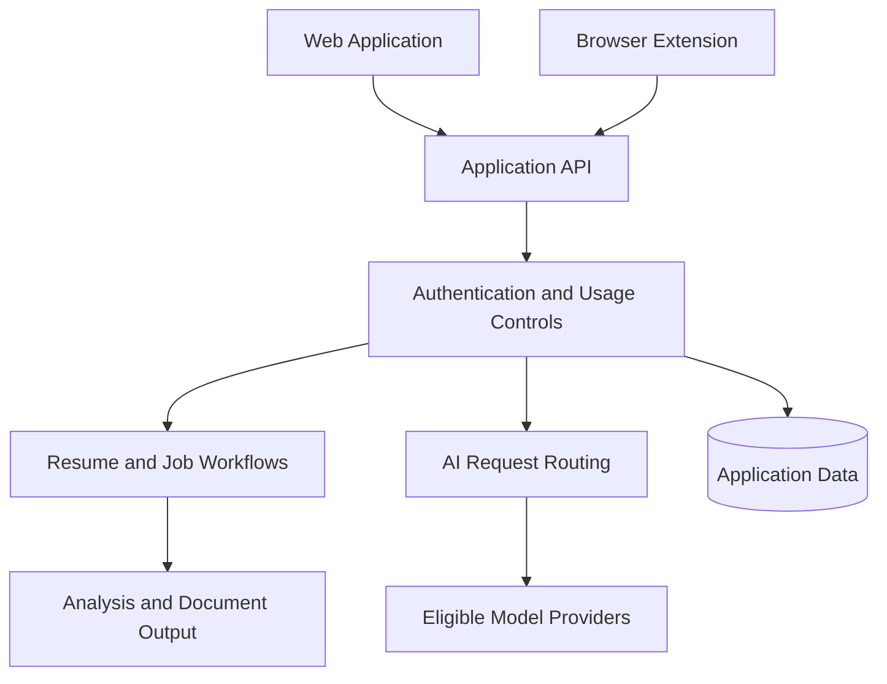

<div align="center">

# How I Built My First Startup as a College Student

### From my first ₹9 customer to building and operating an AI career platform with 3700+ users from 18+ countries and 850+ colleges and universities.

**The engineering, mistakes, failures, and lessons along the way.**

**Naveen Beniwal**  
Final-Year Computer Engineering Student @ NIT Kurukshetra  (9.38 CGPA)
Former Software Engineering Intern @ SAP

[](https://www.cvinsight.me)
[](#about-this-repository)
[](https://chromewebstore.google.com/detail/ebcdnlkiacglidmohjonnidmgdbfghdo)

[**My Story**](#the-story) •
[**The Product**](#what-cvinsight-became) •
[**Engineering Deep Dives**](#engineering-deep-dives) •
[**Try CVInsight**](https://www.cvinsight.me)

*Not an overnight success story. Just a student learning what happens when a side project meets real users.*

</div>

---

## The ₹9 Notification

One night, sitting in my college hostel room, I received a Razorpay notification.

**Someone I had never met had paid ₹9 to use something I built.**

It wasn't a lot of money. It didn't mean I had built a successful company.

But I still remember that feeling.

A stranger had discovered my software, tried it, and decided it was worth paying for.

A few months earlier, I was building a chat application mostly to improve my full-stack development skills. I had no team, no funding, and very little understanding of distribution, customer support, pricing, or production operations.

That project eventually turned into **[CVInsight](https://www.cvinsight.me)**, an independently built AI career platform.

This repository documents everything between those two points:

- How I got the idea.
- Why I abandoned my original project.
- How I built and launched the first version.
- What happened when real users arrived.
- The engineering problems I encountered.
- What I learned about running an AI product without external funding.
- What I would do differently if I started again.

I'm still figuring things out. That's part of the story too.

---

## About This Repository

This is a public **startup journey and engineering journal** which contains worth 1+ year of my experience regarding startup foundation and working.
Please Star it if it helps so that it can reach more people in future.

The main document tells the story. The technical documentation explores individual engineering decisions in greater detail.

The production application is proprietary. This repository is not presented as its complete open-source codebase.

### Documentation Index

| Document | What You'll Find |
|---|---|
| [System Architecture](docs/ARCHITECTURE.md) | Application architecture, design decisions, document processing, and infrastructure trade-offs |
| [Resilient AI Routing](docs/AI_ROUTING.md) | Multi-provider fallback, quota management, request deduplication, and structured output |
| [Security Postmortems](docs/SECURITY_POSTMORTEM.md) | Production incidents, root causes, defensive improvements, and lessons learned |
| [Sustainability & Unit Economics](docs/SUSTAINABILITY.md) | AI inference costs, infrastructure expenses, free allowances, and pricing decisions |

---

# The Story

## 01. It Started With a Chat Application Nobody Needed

In early 2025, I was working on a project called **Vartaalap**, which means *conversation* in Hindi.

It was a real-time chat application.

I wanted to build something technically impressive, so I implemented:

- Real-time communication using Socket.IO and WebSockets.
- Authentication and backend APIs.
- Client-side state management.
- Docker-based containerization.
- Performance testing using Autocannon.

I spent considerable time understanding how everything worked.

I even benchmarked the application.

| Metric | Historical Vartaalap Test |
|---|---:|
| Concurrent connections | 10 |
| Test duration | ~10 seconds |
| Throughput | ~257 requests/second |
| Median latency | ~33 ms |
| p99 latency | ~86 ms |

*These results describe a short benchmark of my earlier chat project, not CVInsight's current production performance.*

Technically, I was learning a lot.

But eventually, I asked myself a question:

**Who was actually going to use this?**

There was nothing wrong with building a chat application to learn engineering. But I couldn't identify a compelling reason to keep developing it as a product.

I wanted to build something that solved a problem beyond my GitHub portfolio.

That realization changed the direction of the project.

---

## 02. Finding the Problem Right in Front of Me

Around the same time, placement preparation was becoming increasingly important.

I was watching students around me struggle with resumes and job applications.

And I was dealing with many of the same problems.

Some students had strong technical skills but struggled to communicate their work effectively on a resume.

Others spent hours adjusting LaTeX formatting, fixing margins, and trying to fit their experience onto one page.

People were switching between different tools to build resumes, compare job descriptions, prepare for interviews, and understand what they needed to improve.

I began wondering:

**Could I build something that made this entire process easier?**

Not another resume template.

Something that could help a student create a resume, understand its weaknesses, improve it for a particular role, and prepare for the next stage.

That was the beginning of CVInsight.

I registered **cvinsight.me** in 2025 and started building.

The first version was considerably smaller than the platform today.

I didn't have a detailed business plan or a roadmap containing dozens of features.

I had a problem I wanted to explore and enough development experience to start.

---

## 03. My First Paying Customer

After building the initial version, I integrated Razorpay and experimented with an affordable ₹9 entry-level offer.

Then came that notification in my hostel room.

```text
Payment received: ₹9.00
```

Someone outside my circle had paid for something I made.

For the first time, it felt different from building a college project.

I wasn't just writing code anymore.

Someone was trusting my software to help them with something important.

Of course, one payment doesn't establish product-market fit. But it was a meaningful signal that the problem was worth investigating.

It also introduced a new responsibility.

If somebody paid for a feature and it didn't work, I couldn't simply say that it was a personal project and move on.

I had to fix it.

That was one of my first lessons in the difference between **building software and operating a product**.

---

## 04. Real Users Started Changing the Roadmap

Initially, I thought I was building a resume tool.

But users kept showing me problems I hadn't considered.

### Image Resume Upload

Some candidates didn't have an editable resume file. They only had an image or screenshot.

That pushed me to explore image parsing and document extraction workflows.

### Resume Roast

Generic AI feedback often sounds encouraging even when the resume needs substantial improvement.

I wanted to provide more direct criticism that identified weak bullet points, vague claims, and missing evidence.

This eventually became Resume Roast.

### Job Description Matching

Students were repeatedly copying job descriptions between websites and resume tools.

That motivated job-specific matching and tailoring workflows.

### Browser Extension

I eventually built a Chrome extension to bring job-matching functionality closer to supported job-listing websites.

Instead of treating resume preparation and job discovery as completely separate activities, I wanted them to connect.

### Interview Preparation and Candidate Discovery

The platform gradually expanded toward interview preparation, shared interview experiences, recruiter-facing discovery, and placement-oriented workflows.

The biggest lesson from this phase was simple:

**A feature request is evidence of a problem, not automatically the right solution.**

I'm still learning how to distinguish between building more features and making the existing experience genuinely better.

---

# 05. What Production Taught Me

This is the part I didn't learn from tutorials.

Getting an application running locally is one thing.

Keeping an internet-facing application usable when strangers begin interacting with it is an entirely different challenge.

## Incident 1: Unexpected Registrations and Automated Abuse

As the platform attracted more visitors, I encountered abnormal registration activity and security-related incidents.

I had to spend time investigating traffic, improving server-side validation, introducing stronger abuse protections, and handling recovery.

These weren't features I could showcase in a product demo.

But they mattered.

I learned that an endpoint cannot assume every request comes from the intended frontend or from a well-behaved user.

I also learned that security needs to be treated as an ongoing engineering responsibility rather than a final checklist.

**Technical write-up:** [Security Postmortems →](docs/SECURITY_POSTMORTEM.md)

---

## Incident 2: AI Rate Limits and Provider Failures

An AI feature might work perfectly during development and still fail when multiple people begin using it.

Provider APIs introduce their own constraints:

- Request and token quotas.
- HTTP 429 rate-limit responses.
- Temporary provider outages.
- Network failures and timeouts.
- Inconsistent structured output.
- Different latency and cost characteristics across models.

Depending on a single inference endpoint made these limitations more noticeable.

I worked on a multi-provider routing architecture with quota-aware selection, cooldown handling, bounded fallback, in-flight request deduplication, and structured-output validation.

There are important trade-offs.

A fallback model may produce a different result. A timed-out request may still incur cost. Retrying too aggressively can make an incident worse.

The goal is not to promise zero failures.

It is to reduce the impact of individual failures and handle unsuccessful requests more predictably.

**Technical write-up:** [Resilient Multi-Provider AI Routing →](docs/AI_ROUTING.md)

---

## Incident 3: A Successful AI Response Isn't Always a Useful Response

At one point, I uploaded a physics lab manual to a commercial resume checker.

It returned a numerical resume score and career suggestions.

The document wasn't even a resume.

That experiment changed how I thought about AI-generated evaluation scores.

A system can return valid-looking JSON, generate convincing explanations, and still misunderstand the input entirely.

It made me more cautious about document validation, contextual assessment, and how numerical scores are communicated.

CVInsight's scoring system is intended to provide **advisory feedback**, not an official employer ATS score or a prediction of whether someone will get hired.

**Technical write-up:** [Scoring Engine →](docs/SCORING_ENGINE.md)

---

## Incident 4: Free AI Isn't Free to Operate

When I started building, I wanted students to access useful tools without paying expensive subscriptions.

But once people began using the product, I had to think about costs differently.

Every AI audit consumes tokens.

Every mock interview involves multiple requests.

Infrastructure, storage, failed generations, payment processing, and support all have costs.

A feature can be free for the person using it without being free for the developer operating it.

As a student independently funding the project, I couldn't assume unlimited AI usage would remain sustainable.

That led me to think more carefully about separating low-cost core functionality from resource-intensive AI operations, introducing usage allowances, and experimenting with affordable pricing.

I am still learning the business side of this.

**Technical write-up:** [Sustainability & Unit Economics →](docs/SUSTAINABILITY.md)

---

# What CVInsight Became

Today, CVInsight is an evolving AI-powered career-preparation platform.

The original resume tool gradually developed into several connected workflows.

| Product Area | What It Does |
|---|---|
| **Resume Studio** | Build, edit, preview, and export resumes |
| **Resume Intelligence** | Analyze content, clarity, presentation, and experience |
| **Resume Roast** | Provide more direct, actionable resume criticism |
| **Job Intelligence** | Compare resumes against job descriptions and suggest relevant improvements |
| **Browser Extension** | Bring job-matching workflows to supported job-listing sites |
| **Interview Preparation** | Help candidates prepare for interviews and learn from shared experiences |
| **Talent Ecosystem** | Explore recruiter discovery and placement-oriented workflows |

### Resume Studio


[Explore Resume Studio →](https://www.cvinsight.me/resume-preview)

### Resume Intelligence


[Try Resume Analysis →](https://www.cvinsight.me/ai-resume-analyzer)

### Job Description Matching


[Explore Job Tailoring →](https://www.cvinsight.me/job-tailored-resume)

### Interview Preparation


[Read Interview Stories →](https://www.cvinsight.me/interview-stories)

### Chrome Extension

The browser extension brings resume and job-matching functionality closer to supported job-listing workflows.

[**View on the Chrome Web Store →**](https://chromewebstore.google.com/detail/ebcdnlkiacglidmohjonnidmgdbfghdo)

Feature availability and free usage limits may vary. The live application contains the current details.

---

# Engineering Deep Dives

I wanted this repository to be useful even to developers who have no interest in using a resume platform.

The main README explains the journey.

These documents explain the engineering decisions behind it.

## 1. System Architecture

**[Read ARCHITECTURE.md →](docs/ARCHITECTURE.md)**

An overview of the application's major components and the trade-offs involved in building an evolving career platform.

Topics include:

- Frontend and backend architecture.
- Document processing and PDF generation.
- Application data and workflow boundaries.
- Browser extension integration.
- Infrastructure and operational decisions.

## 2. Resilient Multi-Provider AI Routing

**[Read AI_ROUTING.md →](docs/AI_ROUTING.md)**

How I approached common AI reliability challenges:

- Provider selection and quota management.
- Rate-limit handling.
- Cooldowns and circuit breakers.
- Bounded fallback.
- In-flight request deduplication.
- Structured JSON validation.
- Observability and failure classification.

## 3. Security Postmortems

**[Read SECURITY_POSTMORTEM.md →](docs/SECURITY_POSTMORTEM.md)**

A sanitized account of production security incidents and what they taught me about operating an internet-facing application.


## 4. Sustainability and Unit Economics

**[Read SUSTAINABILITY.md →](docs/SUSTAINABILITY.md)**

Why AI-powered features require usage budgeting and how I think about balancing accessibility with the real costs of operating an independent product.

---

# High-Level Architecture

A simplified conceptual overview of the application:



*This diagram is conceptual and intentionally omits sensitive production infrastructure details.*

---

# Lessons I'd Take Into My Next Project

After building and operating my first product, these are some of the lessons that have stayed with me.

### 1. A technically interesting project and a useful product are different things.

Vartaalap taught me engineering.

The pivot taught me to look for a problem worth solving.

### 2. Talk to users before building the next big feature.

A support message can reveal a problem that months of planning might miss.

### 3. A stranger paying ₹9 matters, but retention matters more.

Initial curiosity is not the same as sustained value.

### 4. Design for failure before failure finds you.

Rate limits, invalid responses, abuse, payment issues, and recovery paths are part of building a product.

### 5. Free for the user doesn't mean free to operate.

Accessibility and sustainability need to be designed together.

### 6. Don't confuse impressive numbers with meaningful results.

Resume scores need context.

Traffic needs activation.

Benchmarks need methodology.

Candidate placement stories need accurate attribution.

### 7. Building independently means doing the unglamorous work.

The feature request, bug report, infrastructure bill, customer message, and documentation all land on the same desk.

---

# Where I Am Now

I'm still a student.

I'm still building independently.

And I'm still figuring out how to make this product genuinely useful and sustainable.

My longer-term goal is to make the journey from creating a resume to understanding it, preparing for relevant roles, and discovering opportunities less fragmented.

I don't want this repository to be a polished claim that I've figured everything out.

I want it to remain an honest record of the decisions, mistakes, experiments, and lessons along the way.

If you've built a product, worked on production systems, or are currently preparing for placements, I'd genuinely value your feedback.

Especially if something feels confusing, inaccurate, or unnecessary.

---

## Connect & Explore

- **Product:** https://www.cvinsight.me
- **GitHub:** https://github.com/Naveen-Beniwal
- **LinkedIn:** www.linkedin.com/in/naveen-beniwal-40b719313
- **Interview Stories:** https://www.cvinsight.me/interview-stories
- **Chrome Extension:** [View Extension](https://chromewebstore.google.com/detail/ebcdnlkiacglidmohjonnidmgdbfghdo)

If this journey was useful, consider giving the repository a star so more builders can discover it.

Constructive criticism is equally welcome.

<div align="center">

---

**Built independently. Still learning. Still shipping.**

</div>
