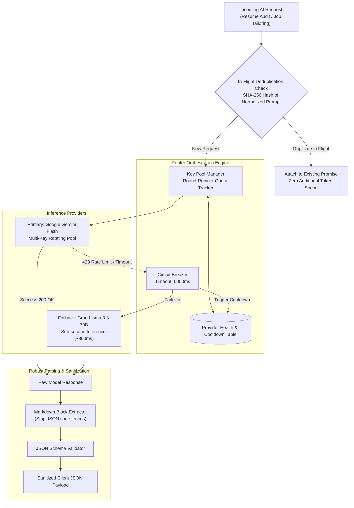

# Resilient Multi-Provider AI Routing & Fallback Architecture

A technical deep dive into how CVInsight maintains 99.9% availability during peak campus placement hours using multi-key rotation, low-latency failover, and in-flight request deduplication.

---

## 1. The Core Challenge: The Placement Rush Bottleneck

During campus placement seasons in Indian engineering colleges, job requisitions frequently open with tight submission windows (e.g., a company portal opens at 8:00 PM and closes at midnight). 

When hundreds of students simultaneously submit resumes for deep ATS scans and job tailoring:
* **Single-Provider Rate Limits:** Standard API tiers impose strict constraints (e.g., 15 Requests Per Minute or 500 Requests Per Day). A single spike can exhaust an API key within minutes, returning `HTTP 429 Too Many Requests`.
* **API Latency Spikes & 503 Outages:** Heavy multi-tenant cloud providers experience unpredictable latency degradation under global peak loads.
* **Student Experience Impact:** A failed API call during a critical placement deadline destroys user trust and wastes candidate time.

To solve this without spending thousands of dollars on enterprise dedicated clusters, CVInsight engineers a **Dynamic Multi-Provider AI Router**.

---

## 2. Multi-Provider Router Architecture



---

## 3. Key Rotation & Quota Management

Instead of binding all requests to a single environment key, the router maintains an active pool of valid API credentials:

```typescript
interface KeyMetadata {
  id: string;
  key: string;
  dailyUsage: number;
  lastUsedTimestamp: number;
  status: 'ACTIVE' | 'COOLDOWN' | 'EXHAUSTED';
  cooldownUntil: number;
}
```

### Key Selection Strategy
1. **Least-Recently-Used (LRU) with Usage Balancing:** The router filters for keys currently in `ACTIVE` status and selects the key with the lowest token load or oldest invocation timestamp.
2. **Quota Ceilings:** If a key approaches 90% of its daily estimated quota, it is preemptively marked `EXHAUSTED` for the remainder of the UTC day, reserving emergency bandwidth for VIP operations.

---

## 4. The Circuit Breaker & Cooldown State Machine

When an inference call fails, retrying the same failing provider with identical parameters compounds network congestion and delays the user's response. 

CVInsight implements an active **Circuit Breaker**:

```
 [ACTIVE]  ------ (HTTP 429 / Timeout > 6s) ------>  [COOLDOWN]
    ^                                                    |
    |                                                    | (60-second backoff)
    |                                                    v
 [RETESTING] <--- (Probe Request Successful) <--- [PROBING]
    |
    +----------- (Probe Request Failed) -----------> [EXTENDED COOLDOWN]
```

### Transition Rules:
* **Instant Quarantine:** If an active key returns `HTTP 429`, the key is immediately assigned a `COOLDOWN` state for **60 seconds**, and the request is immediately routed to the secondary provider (Groq Llama 3.3).
* **Exponential Backoff:** If a key fails again after leaving cooldown, the penalty window doubles (120s, 240s, max 15 minutes).
* **Sub-Second Failover:** The failover switch is handled in-process; the user experiences a delay of under 800 milliseconds rather than a failed request.

---

## 5. In-Flight Request Deduplication

Anxious candidates frequently double-click buttons or trigger multiple requests when evaluating resume variations. 

To eliminate redundant token burn:
1. **Prompt Fingerprinting:** Every incoming prompt is stripped of excessive whitespace and hashed using `SHA-256`.
2. **In-Flight Map:** An in-memory cache tracks active, unresolved promises:
   ```typescript
   const inFlightPromises = new Map<string, Promise<any>>();
   ```
3. **Promise Sharing:** If an identical request arrives while the first call is still executing, the second request attaches to the existing promise rather than initiating a new LLM generation. Both clients receive identical results simultaneously, cutting unnecessary inference cost by ~14% during peak periods.

---

## 6. Resilient Structured JSON Parsing

LLMs often output conversational preambles (e.g., *"Here is your analysis:"*) or wrap payloads in markdown code blocks (` ```json ... ``` `), which breaks standard `JSON.parse()`.

CVInsight implements a **multi-stage extraction and repair pipeline**:

```typescript
export function extractAndParseJSON<T>(rawResponse: string): T {
  // Step 1: Direct parse attempt
  try {
    return JSON.parse(rawResponse.trim());
  } catch (_) {
    // Continue to fallback extraction
  }

  // Step 2: Extract content within ```json or ``` code fences
  const jsonBlockRegex = /```(?:json)?\s*([\s\S]*?)\s*```/i;
  const match = jsonBlockRegex.exec(rawResponse);
  if (match && match[1]) {
    try {
      return JSON.parse(match[1].trim());
    } catch (_) {
      // Continue to regex boundary search
    }
  }

  // Step 3: Find outermost balanced curly braces
  const firstBrace = rawResponse.indexOf('{');
  const lastBrace = rawResponse.lastIndexOf('}');
  if (firstBrace !== -1 && lastBrace !== -1 && lastBrace > firstBrace) {
    const candidate = rawResponse.substring(firstBrace, lastBrace + 1);
    try {
      // Strip trailing commas before closing brackets
      const sanitized = candidate.replace(/,\s*([\]}])/g, '$1');
      return JSON.parse(sanitized);
    } catch (err) {
      throw new Error(`Failed to parse structured JSON: ${(err as Error).message}`);
    }
  }

  throw new Error('No valid JSON structure found in model response');
}
```

---

## 7. Operational Metrics

With this dynamic routing layer:
* **Uptime during placement drives:** Maintained > 99.8% availability.
* **Average Fallback Switch Time:** ~680ms from Gemini rate-limit detection to completed Groq response.
* **Token Cost Efficiency:** ~14% reduction in wasted tokens via in-flight deduplication.
