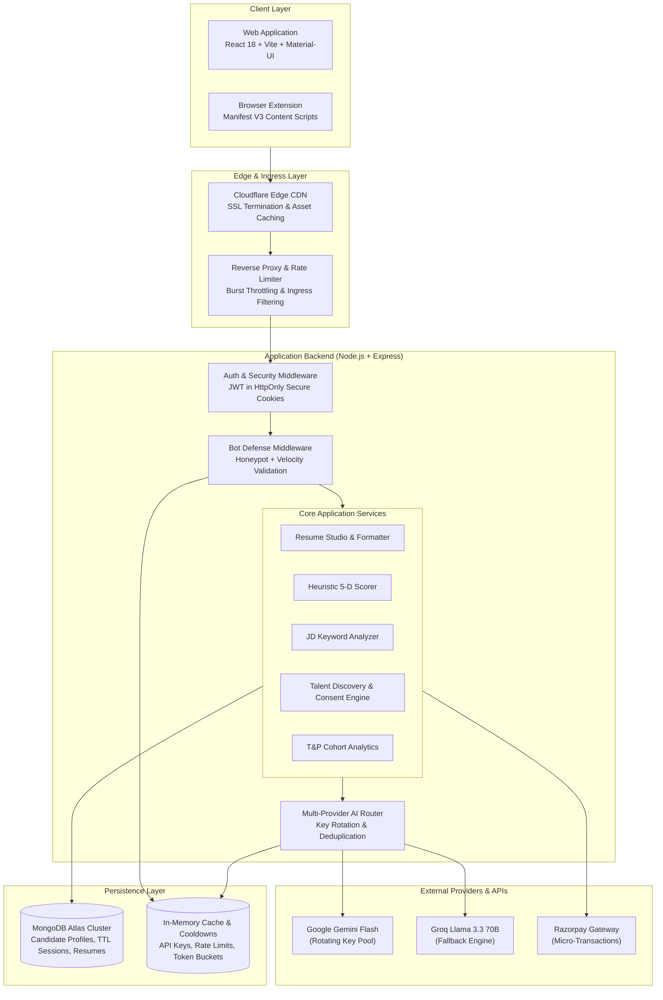
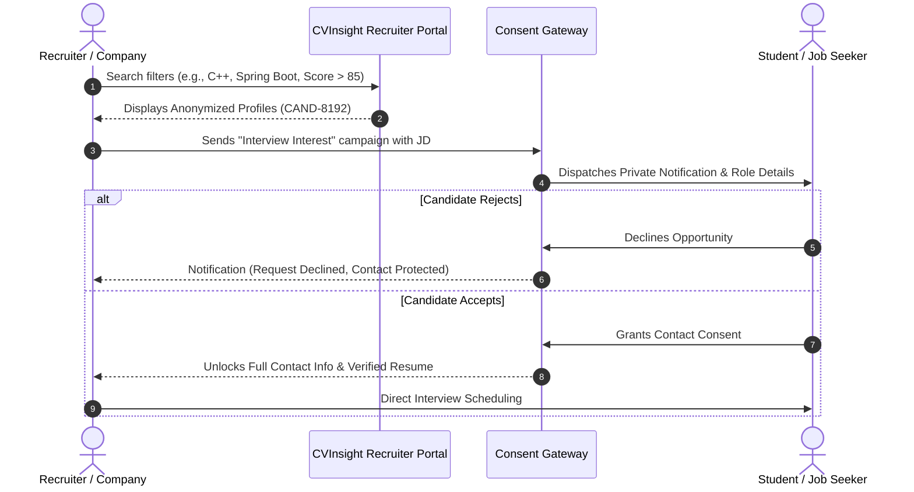

# CVInsight System Architecture & Engineering Deep Dive

An in-depth technical analysis of CVInsight's full-stack architecture, request lifecycles, PDF rendering pipelines, and data models.

---

## 1. System Overview

CVInsight is architected as a distributed career intelligence platform comprised of four decoupled operational environments:



---

## 2. Frontend Layer (React 18 + Vite)

### Architecture Principles
* **State Management:** Decoupled UI state using **Zustand** stores (`resumeStore`, `authStore`, `themeStore`) to eliminate prop-drilling across multi-step wizard layouts.
* **Component System:** Built on **Material-UI (MUI v5)** with custom styled engine wrappers, supporting dynamic runtime theme switching (Minimalist, Corporate, Modern, Terminal Dark Mode).
* **Bundle Optimization:** Code-splitting via `React.lazy()` and dynamic imports for heavy components (e.g., CodeMirror, PDF preview canvases, Chart.js analytics).

### Browser Extension (Manifest V3)
* **Isolated Content Scripts:** Dynamically injected into LinkedIn Job Requisitions (`linkedin.com/jobs/*`), Naukri (`naukri.com/job-listings*`), and Superset placement portals.
* **Non-Invasive DOM Injection:** Utilizes a lightweight Shadow DOM container to prevent host-page CSS leakage from polluting the extension's keyword overlay.
* **Secure Background Messaging:** Uses Chrome's asynchronous message passing (`chrome.runtime.sendMessage`) communicating with an active background service worker. User authentication is preserved via secure token verification against the web origin.

---

## 3. The PDF Generation Pipeline: Technical Trade-Offs

Generating standardized, single-page, ATS-compliant PDFs in a web application presents major engineering trade-offs. 

```
                                  +---------------------------+
                                  | Resume State / Raw Data   |
                                  +-------------+-------------+
                                                |
               +--------------------------------+-------------------------------+
               |                                |                               |
               v                                v                               v
    [Path 1: Client Canvas]          [Path 2: Native Vector]          [Path 3: Pure LaTeX]
      html2pdf.js + html2canvas           window.print()                 apex_resume.tex
               |                                |                               |
    * DOM Clone & Font Sync          * @media print rules             * pdflatex / Overleaf
    * 210mm A4 dimension lock        * Pure vector text               * Mathematical typography
    * 1.8x DPI Canvas Raster         * Native browser engine          * Exact micro-spacing
               |                                |                               |
               v                                v                               v
       [High-DPI PDF]                  [Vector Print PDF]              [Perfect Vector PDF]
   Instant, zero server cost         Selectable, crisp vectors       Publisher quality, 0% errors
```

### Why We Rejected Server-Side Headless Chromium (Puppeteer / Playwright)
Many commercial builders spin up headless Chrome containers on AWS Lambda or EC2 to render HTML to PDF via `page.pdf()`. We evaluated and deliberately rejected this approach for three core reasons:
1. **Cold Starts & Latency:** Spawning a Chromium instance inside a serverless function introduces a 2.5–5.0 second latency spike per download.
2. **Memory Footprint:** Headless Chromium requires 512MB–1GB RAM per worker, which drastically increases operational costs on budget infrastructure during placement surges.
3. **Privacy by Design:** Handling student resume data entirely client-side ensures that private contact information, addresses, and phone numbers are never stored in server temporary directories.

### Path 1: Client-Side High-DPI Document Generation (`html2pdf.js` + `html2canvas`)
For users wanting a fast 1-click download directly from the browser:
* The live resume DOM node is deep-cloned into an off-screen staging iframe.
* Active UI scaling and CSS zoom transforms are stripped, and container width is locked to exactly `210mm` (A4 standard width).
* The pipeline awaits `document.fonts.ready` before rendering to guarantee that Lato or Roboto font glyphs do not trigger layout shifts or text overlaps.
* Rendered at `scale: 1.8` onto an HTML5 canvas. This resolution produces crisp typography (300+ effective DPI) while maintaining an average output file size under 600 KB.

### Path 2: Native Browser Vector Printing (`window.print()`)
For users demanding 100% selectable, crisp vector text without rasterization:
* We provide a dedicated `@media print` stylesheet that strips navigation bars, toolbars, and background artifacts.
* Page margins are locked to `@page { size: A4; margin: 0; }`.
* The browser's native PDF generation engine outputs true vector text paths with zero pixelation at any zoom level.

### Path 3: Mathematical Vector Typesetting (`apex_resume.tex`)
For technical candidates applying to competitive software engineering or quantitative finance roles where typography must be mathematically exact:
* CVInsight outputs clean, self-contained LaTeX source code matching the [`apex_resume.tex`](../apex_resume.tex) structure.
* Direct compatibility with [Overleaf](https://www.overleaf.com) and local `pdflatex` / `xelatex` compilers.

---

## 4. Backend Architecture & Security Gateway

### Middleware Stack
1. **Security Headers (`helmet`):** Strict Content-Security-Policy (CSP), frameguard, and XSS filtering.
2. **Cookie-Based JWT Authentication:** Authentication tokens are stored in `HttpOnly`, `Secure`, `SameSite=Lax` cookies, neutralizing malicious scripts from accessing session tokens via `document.cookie`.
3. **NoSQL Injection Defense:** Incoming request payloads pass through sanitizers that strip `$` and `.` operators to prevent MongoDB operator injection.
4. **Sliding-Window Rate Limiting:** Applied to high-cost routes (e.g., `/api/ai/deep-scan`, `/api/ai/roast`) using in-memory token buckets to prevent automated abuse.

### Anti-Bot Detection Gateway
To prevent scraping bots from burning AI token budgets:
* **Honeypot Form Fields:** Invisible inputs added to client forms that are ignored by human users but populated by automated spam scripts.
* **Submission Velocity Heuristics:** Timestamp deltas are evaluated between form mount and submission. Submissions occurring with non-human velocity are rejected.
* **Origin & Header Validation:** API endpoints require standard custom application headers, rejecting headless `curl` and automated bot requests.

---

## 5. Recruiter Portal & Placement Cell Architecture

### Anonymized Talent Portfolios
To eliminate hiring bias and prevent unsolicited recruiter spam:
* Candidates are indexed by technical skills, verified CGPA, years of experience, and their 5-Dimensional CVInsight score.
* Candidate names, phone numbers, email addresses, and GitHub handles are redacted into anonymized IDs (`CAND-74921`).
* Recruiters browse candidate profiles based strictly on technical competence.



### College T&P Analytics & Pitch Deck Generator
For Training & Placement (T&P) Cells:
* **Cohort Readiness Metrics:** Aggregates departmental strengths (e.g., 68% of CSE cohort ready for backend microservices; 24% requiring system design remediation).
* **1-Click Pitch Deck Export:** Generates anonymized data packages showcasing cohort skill distributions to prospective corporate recruiters.

---

## 6. Database Design (MongoDB Atlas)

CVInsight leverages MongoDB Atlas configured with compound indexing and automated TTL expiry:

| Collection | Key Fields | Index Strategy | Purpose |
| :--- | :--- | :--- | :--- |
| `users` | `email`, `role`, `tier`, `credits` | Unique index on `email` | Authentication, billing quotas, and role-based permissions |
| `resumes` | `userId`, `personalInfo`, `experience`, `projects` | Compound index on `{ userId: 1, updatedAt: -1 }` | Fast retrieval of user drafts and version history |
| `talent_pool` | `skills`, `overallScore`, `isAvailable`, `anonymizedId` | Multikey index on `skills`, compound on `{ overallScore: -1 }` | Fast candidate discovery queries for recruiter searches |
| `rate_limits` | `ipAddress`, `actionType`, `count`, `createdAt` | Compound index on `{ ipAddress: 1, actionType: 1 }`, TTL on `createdAt` | Distributed rate limiting and abusive burst suppression |
| `sessions` | `sessionId`, `csrfToken`, `expiresAt` | TTL index on `expiresAt` | Ephemeral guest sessions automatically pruned by MongoDB |

---

## 7. Operational Reliability Summary

Through this architecture, CVInsight achieves:
* **Sub-second client-side document exports** without server compute costs.
* **Zero credential exposure** with hardened cookie-based sessions.
* **Resilient multi-provider AI routing** maintaining high uptime through campus placement rushes.
