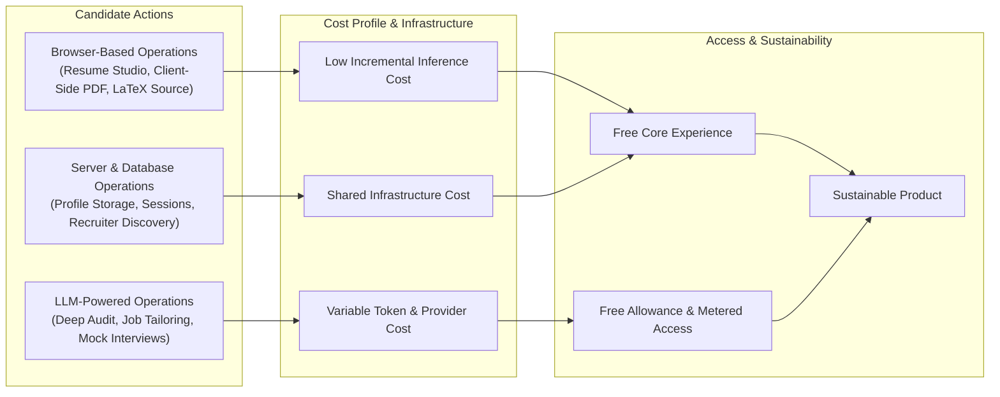

# Engineering for Sustainable AI Access: Unit Economics & Operating Constraints

A transparent, mathematically defensible breakdown of the unit economics, token cost models, infrastructure overhead, and architectural lessons behind operating CVInsight independently.

---

## 1. The Economics of AI Software

When developing consumer applications powered by Large Language Models, developers often encounter a fundamental tension between user accessibility and resource economics:
* **The Fixed-Subscription Paradigm:** Traditional SaaS platforms typically bundle usage into recurring monthly subscriptions ($20–$30/month). While effective for enterprise predictability, recurring subscriptions present a high barrier for college students and fresh graduates preparing for sporadic placement seasons.
* **The "Zero Marginal Cost" Fallacy:** It is tempting to treat AI software as having zero marginal cost like traditional web hosting. In reality, every LLM token generation incurs tangible compute, bandwidth, and third-party inference expenses.

As a student developer operating without venture capital, subsidizing unmetered generative inference for thousands of active users is mathematically impossible. 

To keep CVInsight continuously accessible, reliable, and independent, we built an operating model grounded in **mathematically defensible unit economics**.

---

## 2. Mathematically Defensible Unit Economics

To evaluate the financial sustainability of any AI-driven feature, the cost must be decomposed into its constituent variables.

### The Single-Request Inference Formula
The nominal direct cost of a single successful model invocation is defined as:

$$C_{\text{request}} = \frac{T_{\text{input}} \cdot P_{\text{input}} + T_{\text{output}} \cdot P_{\text{output}}}{1{,}000{,}000}$$

Where:
* $T_{\text{input}}$ = Total prompt tokens consumed (system prompt, user context, resume payload, schema rules).
* $T_{\text{output}}$ = Total completion tokens generated (structured JSON diagnostics, bullet revisions).
* $P_{\text{input}}$ = Price per million input tokens in local currency.
* $P_{\text{output}}$ = Price per million output tokens in local currency.

---

### The True Cost per User Action
In production, the nominal cost of one inference does **not** represent the true cost of fulfilling an end-user action. Network degradation, model timeouts, client retries, and shared server overhead expand the actual resource consumption:

$$C_{\text{total}} = C_{\text{request}} + C_{\text{retry}} + C_{\text{allocated infrastructure}}$$

Where:
* $C_{\text{retry}}$ = Expected retry and failover cost, modeled as $C_{\text{retry}} = r \cdot C_{\text{fallback}}$, where $r$ is the empirical failure/timeout rate and $C_{\text{fallback}}$ is the secondary provider's inference cost.
* $C_{\text{allocated infrastructure}}$ = Fixed monthly server, database, and ingress expenses amortized over total monthly active operations:

$$C_{\text{allocated infrastructure}} = \frac{\text{Monthly Fixed Infrastructure Cost}}{\text{Monthly Completed User Actions}}$$

---

## 3. Case Study: August 2026 Telemetry & Token Measurements

Based on production telemetry from August 2026 across 1,840 completed resume audits:

| Metric Parameter | Empirical Measurement |
| :--- | :--- |
| **Mean Input Tokens ($T_{\text{input}}$)** | $1{,}420$ tokens (System prompt: 480 tokens, Parsed resume: 940 tokens) |
| **Mean Output Tokens ($T_{\text{output}}$)** | $680$ tokens (5-D Diagnostic JSON, bullet refactorings) |
| **Primary Provider Input Price ($P_{\text{input}}$)** | ₹6.25 per million tokens (~$0.075 / MTok) |
| **Primary Provider Output Price ($P_{\text{output}}$)** | ₹25.00 per million tokens (~$0.30 / MTok) |
| **Nominal Inference Cost ($C_{\text{request}}$)** | $\frac{(1420 \times 6.25) + (680 \times 25.00)}{1{,}000{,}000} \approx \mathbf{\text{₹}0.0259}$ |
| **Retry & Failover Overhead ($C_{\text{retry}}$)** | $\sim 5.2\%$ failover rate to secondary fallback engine $\approx \mathbf{\text{₹}0.0084}$ |
| **Amortized Infrastructure Overhead ($C_{\text{allocated}}$)** | Fixed cluster + VPS + domain costs amortized $\approx \mathbf{\text{₹}0.0220}$ |
| **Payment Processing & Gateway Margins** | Razorpay 2% transaction fee + 18% GST on micro-passes |
| **True Effective Cost per Audit Action ($C_{\text{total}}$)** | $\mathbf{\sim \text{₹}0.060 \text{ to } \text{₹}0.095}$ per completed action |

### Understanding Free-Tier Credits
Cloud providers and AI platforms often grant promotional or free-tier usage allowances. While these allowances temporarily reduce immediate cash expenditures, they do not eliminate the underlying resource cost. Designing software architecture under the assumption that third-party compute will remain free indefinitely creates fragile systems that collapse when promotional quotas expire. 

CVInsight's pricing and caching mechanisms were engineered to remain solvent under full commercial API rates.

---

## 4. Architectural Cost Framing

Rather than claiming that server-side functionality has "zero cost," CVInsight decouples features into distinct operational categories based on their compute characteristics:

### 1. Browser-Based Operations (Low Incremental Inference Cost)
* **Features:** Resume Studio editing, 8 ATS typographic layouts, single-page LaTeX export, and high-DPI client-side PDF export (`html2canvas`).
* **Cost Profile:** Compute is performed directly on the client machine; incremental server load per download is near zero.
* **Access Policy:** Free and unmetered for all candidates.

### 2. Server & Database Operations (Shared Infrastructure Cost)
* **Features:** User authentication, encrypted profile storage, recruiter talent discovery, and college cohort analytics.
* **Cost Profile:** Fixed monthly operational baseline (MongoDB Atlas cluster, cloud VPS, Nginx reverse proxy, Cloudflare CDN).
* **Access Policy:** Free for candidates; costs are amortized across the entire platform.

### 3. LLM-Powered Operations (Variable Token & Provider Cost)
* **Features:** Deep resume scans, Google XYZ bullet rewriting, company-specific technical interview roadmaps, and job description alignment.
* **Cost Profile:** Incurs direct, variable token expenses per execution according to the $C_{\text{total}}$ formula.
* **Access Policy:** Generous initial free allowance on signup, supported by micro-transaction passes (₹9) for high-frequency users.

---

## 5. What I Got Wrong About Free AI

Reflecting on the evolution of CVInsight, my understanding of software economics underwent several major shifts:

### Misconception 1: "Software is pure code, so I can make everything free"
When I launched CVInsight, my instinct was to give away every single feature for free. I wanted any student, regardless of background, to have unlimited access to deep resume evaluations.
* **The Reality:** As daily active users crossed into the thousands, API rate limits hit hard. An application cannot be "free" if upstream providers cut off access during peak hours (HTTP 429), leaving students stranded right before placement deadlines.

### Misconception 2: "User usage will be evenly distributed"
I initially assumed users would audit their resume 1–2 times, make improvements, and be satisfied.
* **The Reality:** Production logs revealed an extreme **80/20 distribution**. Roughly 6% of active users—alongside automated scraping scripts—accounted for over 65% of total token volume by repeatedly clicking re-analyze on minor punctuation changes. Without rate limits and micro-metering, a handful of power users consumed the quota meant for the entire cohort.

### Misconception 3: "Pricing is a business topic, separate from engineering"
I used to believe that product architecture and monetization were separate domains: write code first, figure out business later.
* **The Reality:** **Free allowances, routing efficiency, bot defense, and micro-pricing are interconnected engineering decisions.**
  * Adding in-flight request deduplication reduced token burn by 14%.
  * Client-side PDF generation saved hundreds of dollars in headless Chromium cloud server instances.
  * Introducing a nominal ₹9 micro-pass instantly eliminated low-effort API abuse while keeping access completely within reach for students.

---

## 6. The Micro-Pricing Model

Rather than forcing users into recurring monthly subscription commitments, CVInsight pioneered single-action **micro-transactions**:
* **The ₹9 Micro-Pass:** Provides users with a batch of deep AI credits for roughly the price of a cup of tea in a campus cafeteria.
* **Zero Subscription Commitments:** Payments are strictly one-time transactions via UPI/cards; users are never enrolled in recurring auto-debit plans.
* **Recruiter Matching Remains 100% Free for Students:** Candidates never pay to be discovered or contacted by hiring managers.

---

## 7. The Reinvestment Commitment

Every rupee received through CVInsight micro-passes is reinvested directly into platform infrastructure:
1. **Infrastructure Reliability:** Maintaining resilient MongoDB Atlas clusters and cloud VPS instances.
2. **AI Quota Redundancy:** Maintaining active token balances across Google Gemini and Groq fallback pools to guarantee sub-second uptime during placement rushes.
3. **Open-Source Tooling:** Supporting the development of free tools like [`apex_resume.tex`](../apex_resume.tex) and community interview roadmaps.

By aligning technical architecture with transparent economics, CVInsight remains reliable, independent, and sustainable.
